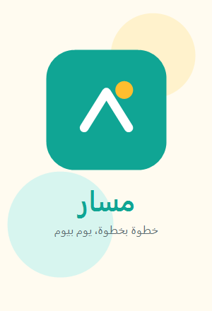
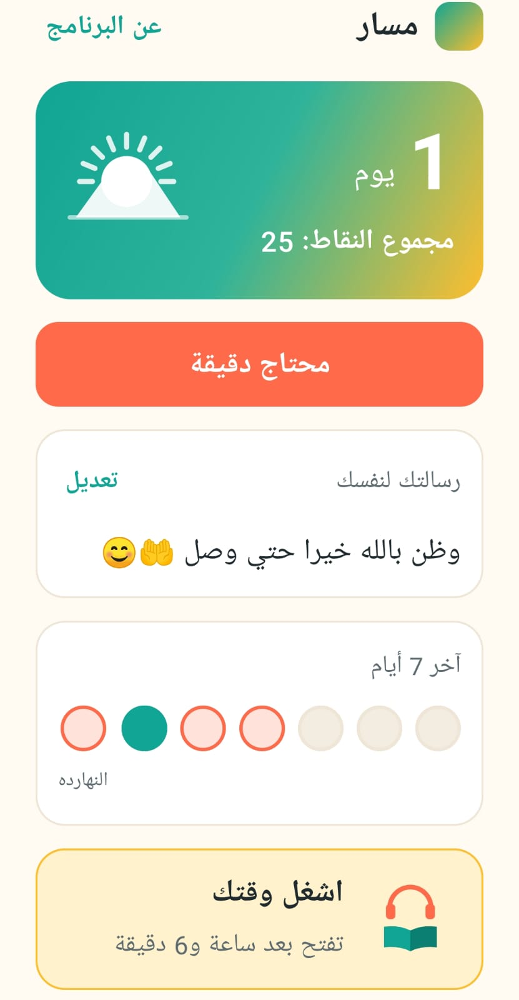
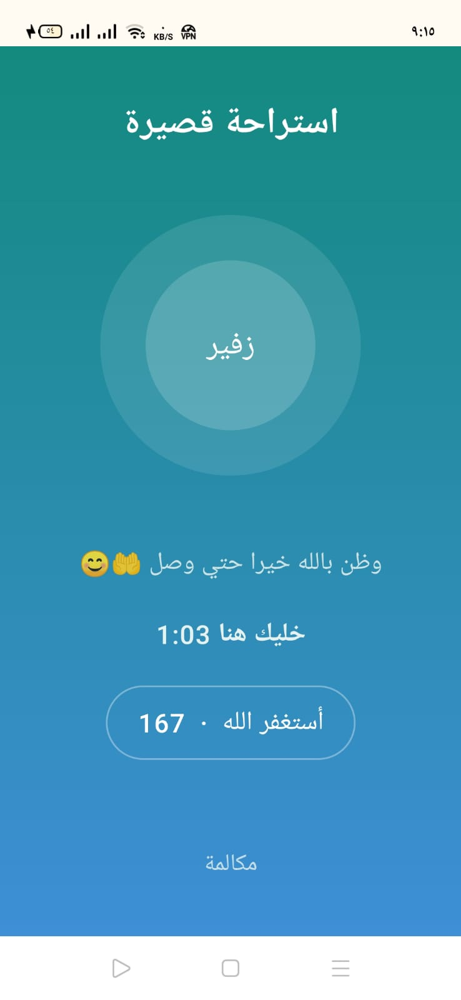
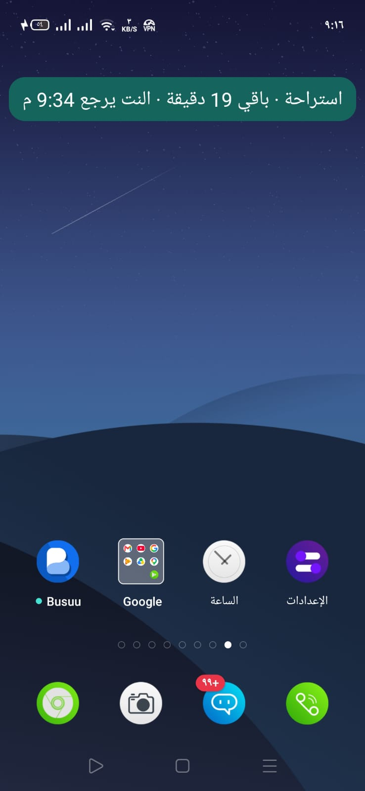
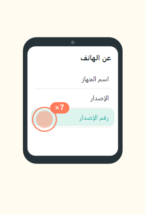
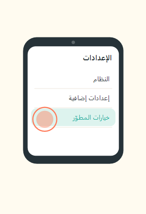
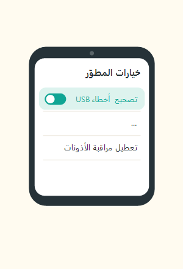
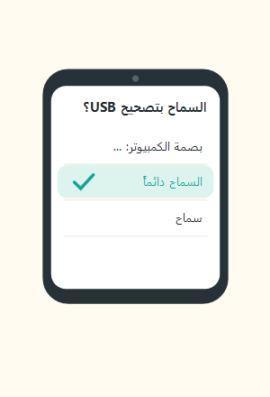

# مسار · Masar

**رفيقك في الطريق — يقف معاك في لحظة الضعف، ويحميك من الانتكاسة.**
**Your companion on the road — it stands with you in the weak moment and guards you from relapse.**

---

### لمحة من داخل البرنامج · A look inside

<table>
  <tr>
    <td align="center"></td>
    <td align="center"></td>
    <td align="center"></td>
  </tr>
  <tr>
    <td align="center"><b>تقدّمك كل يوم</b> Your daily progress</td>
    <td align="center"><b>لحظة تهدئة بدل الانتكاسة</b> Calm instead of relapse</td>
    <td align="center"><b>استراحة محسوبة</b> A timed break</td>
  </tr>
</table>

---

## 🇪🇬 بالعربية

### إيه هو «مسار»؟

الانتكاسة نادراً ما بتيجي بقرار. بتيجي في **لحظة ضعف مفاجئة** — تعب، ضيق، فضول، أو إيد سرحت على التليفون قبل ما العقل يلحق. **مسار** اتصمّم عشان يقف في اللحظة دي بالظبط: يقفل الباب، يكسر الاندفاع، ويدّي العقل فرصة يرجع.

مش مجرد حاجب مواقع. ده رفيق صامت بيمشي مع صاحبه، بيحميه من قرار هيندم عليه لما تهدأ نفسه، وبيحتفل بيه على كل يوم بيعدّيه نضيف — من غير ما حد حواليه يعرف.

### لحظة انتكاسة… خطوة بخطوة

تخيّل السيناريو ده بالكامل:

1. **الإحساس بييجي.** الساعة متأخرة وجالك فضول. فتحت المتصفح وبدأت تكتب كلمة لها مدلول إباحي.
2. **الباب مقفول فوراً.** البحث الآمن بيمنع النتايج تظهر، والموقع نفسه محجوب على مستوى الجهاز — مفيش حاجة بتتفتح أصلاً.
3. **الاندفاع بيتكسر.** مسار بيحسبها محاولة، فالنت بيتقطع شوية (٢٠ دقيقة أول مرة، وبتزيد لو اتكرر)، وبيظهر بانر هادي بيقولك النت هيرجع الساعة كام. السرعة اللي كانت ماشية بيها اللحظة بتقف.
4. **بدل ما تتعاقب، بتتسند.** بتظهر شاشة تهدئة: نفس عميق، عدّاد استغفار، ورسالتك لنفسك اللي كتبتها في لحظة صفا. دقيقتين بس، واللحظة بتعدّي.
5. **رجعت تاني.** النت رجع وكمّلت يومك. ولو اليوم عدّى نضيف، العدّاد بيزيد وتكسب نقطة عمرها ما هتتخصم.

**النتيجة:** اللحظة اللي كانت ممكن تبقى انتكاسة، عدّت — من غير ما توصل لحاجة، ومن غير ما تحسّ إنك اتعاقبت.

### إزاي بيحارب الانتكاسة؟

مسار بيشتغل على **طبقات**، كل واحدة بتمسك اللحظة من زاوية مختلفة — عشان لو طبقة فاتت، اللي بعدها تمسك:

- **بيقفل الوصول** — حجب المواقع الإباحية + بحث آمن إجباري، فالمحتوى مش موجود قدامك أصلاً.
- **بيكسر الاندفاع بالوقت** — القطع المتدرّج بيدّي الرغبة وقت تهدأ فيه (الرغبة بتوصل قمتها وبتنزل خلال دقايق). الوقت ده هو سلاحك.
- **بيحوّل اللحظة لتهدئة** — تنفّس واستغفار بدل الإحساس بالذنب، عشان متدخلش في دوامة لوم بتجرّك لانتكاسة أكبر.
- **بيصعّب القرار المتسرّع** — مينفعش يتمسح في لحظة ضعف؛ الإزالة محتاجة صبر أيام وفيها «تراجع» دايماً.
- **بيكافئ الاستمرار** — كل يوم نضيف نقاط وتقدّم شايفه قدامك، فالدافع بيكبر مع الوقت مش بيقلّ.

### المميزات

- 🛡️ **حجب شامل للمواقع الإباحية** — فلتر على مستوى الجهاز (واي فاي وبيانات)، والبحث الآمن إجباري في جوجل.
- ▶️ **يوتيوب في الوضع الآمن (المقيّد) إجبارياً** — المحتوى غير اللائق محجوب، ومينفعش حد يطفّي الوضع ده.
- ⏱️ **قطع نت متدرّج عند المحاولة** — ٢٠ دقيقة، بعدها ٤٠، بعدها ٥ ساعات، ٨، ١٠… والعدّاد بيرجع للأول بعد يوم كامل نضيف. واتساب والإيميل بيفضلوا شغّالين في القطع الطويل.
- 🔒 **مقاوم للحذف** — مينفعش يتمسح في لحظة ضعف. الإزالة بتستنى ٣٠ أو ٦٠ أو ٩٠ يوم (افتراضي ٩٠)، وفيها زرار **تراجع** في أي وقت.
- 🧘 **شاشة تهدئة بدل العقاب** — تنفّس (شهيق/زفير)، عدّاد استغفار، ورسالتك لنفسك. البرنامج بيسندك مش بيعاقبك.
- 📈 **تتبّع التقدّم** — عدّاد أيام، نقاط (عمرها ما بتتخصم)، وآخر ٧ أيام، ورسالة تشجيع كل صباح محايدة متفضحش حاجة.
- 💬 **حماية تيليجرام** — بيفحص النص الظاهر على الشاشة، ولو ظهر اسم أو نص صريح في بحث أو قناة أو جروب أو شات، بيخرج فوراً ويحسبها محاولة.
- 🏦 **وقفة للتحويل البنكي** — بعض تطبيقات البنوك (زي إنستاباي) بترفض تشتغل والمراقبة مفتوحة، فتقدر توقف المراقبة ١٠ دقايق بإرادتك عشان تحوّل — والفلتر يفضل شغّال والمواقع محجوبة طول الوقت.
- 📱 **تحكّم في التطبيقات** — إنستاجرام وتيك توك وفيسبوك وتطبيقات الصور والفيديو بتتقفل، وأي تطبيق تاني بينزل من Google Play عادي.
- 🔑 **كود طوارئ + «اتأكد من الكود»** — كود للأعطال فقط (مش مخرج، وبيشتغل بعد ساعة انتظار)، وزرار بيتأكد إن الكود مظبوط من غير ما يشغّل أي حاجة.
- 🔄 **تحديث داخل التطبيق** — بضغطة واحدة، ومع الحفاظ على كل تقدّمك ونقاطك وإعداداتك.
- 🔐 **خصوصية كاملة** — الكلام اللي بتكتبه أو الظاهر على الشاشة بيتفحص **في الذاكرة لحظياً** علشان يكتشف المحاولات، وبعدها بيتمسح. **مش بيتحفظ ومش بيطلع من الموبايل خالص.**

### التثبيت من الكمبيوتر

التفعيل بيتم **مرة واحدة** من لابتوب ويندوز، بمعالج مصوّر خطوة بخطوة. مش محتاج تكون خبير — البرنامج بيعمل كل حاجة.

<table>
  <tr>
    <td align="center"></td>
    <td align="center"></td>
    <td align="center"></td>
    <td align="center"></td>
    <td align="center"></td>
  </tr>
  <tr>
    <td align="center">١. فعّل خيارات المطوّر (٧ ضغطات على رقم الإصدار)</td>
    <td align="center">٢. افتح خيارات المطوّر</td>
    <td align="center">٣. شغّل تصحيح أخطاء USB</td>
    <td align="center">٤. وصّل الكابل واسمح بالتصحيح</td>
    <td align="center">٥. خلصنا! 🎉</td>
  </tr>
</table>

بعد كده: شغّل **«Masar Setup»** على اللابتوب، وصّل الموبايل بالكابل، ودوس **ابدأ**. البرنامج بينزّل أدوات أندرويد، ويعمل نسخة احتياطية (اختياري)، ويثبّت ويفعّل نفسه — وكل خطوة بتخلص بتظهر ✓.

وكل التحديثات بعد كده بتيجي **من جوّه التطبيق** بضغطة واحدة، ومع الحفاظ على كل بياناتك — من غير ما توصّل الموبايل بالكمبيوتر تاني.

### الخصوصية أولاً

- النص المكتوب أو الظاهر بيتفحص في الذاكرة لحظياً وبيتمسح فوراً.
- مفيش أي بيانات بتتحفظ أو بتطلع من الموبايل.
- الإشعارات محايدة: اللي حواليك يشوف «استراحة» أو تقدّم عادي، مش أكتر.

---

## 🇬🇧 In English

### What is Masar?

Relapse rarely comes as a decision. It comes in a **sudden moment of weakness** — tiredness, stress, curiosity, or a hand that drifts to the phone before the mind catches up. **Masar** (“path”) is built to stand in exactly that moment: close the door, break the impulse, and give the mind a chance to come back.

It is more than a site blocker. It is a silent companion that walks with the person, protects them from a decision they’ll regret once they calm down, and celebrates every clean day — without anyone around them knowing.

### A relapse moment — step by step

Picture the whole scenario:

1. **The urge arrives.** It’s late and curiosity hits. You open the browser and start typing an explicit word.
2. **The door closes instantly.** SafeSearch stops the results from appearing, and the site itself is blocked at the device level — nothing opens at all.
3. **The impulse breaks.** Masar counts it as an attempt, so the internet cuts for a while (20 minutes the first time, longer if repeated) and a calm banner tells you when it returns. The momentum stops.
4. **Instead of punishment, support.** A calming screen appears: a deep breath, an istighfar counter, and the note you wrote to yourself in a clear moment. Two minutes, and the moment passes.
5. **You’re back.** The internet returns and you carry on. If the day ends clean, your streak grows and you earn a point that is never taken away.

**The result:** the moment that could have become a relapse simply passed — without reaching anything, and without feeling punished.

### How it fights relapse

Masar works in **layers**, each catching the moment from a different angle — so if one layer is missed, the next holds:

- **Closes access** — porn sites are blocked and SafeSearch is forced, so the content isn’t even there.
- **Breaks the impulse with time** — the escalating cut gives the urge time to settle (an urge peaks and fades within minutes). That time is your weapon.
- **Turns the moment into calm** — breathing and remembrance instead of guilt, so you don’t spiral into the shame that drives a bigger relapse.
- **Makes the rash decision hard** — it can’t be deleted in a weak moment; removal takes days of patience and always offers Undo.
- **Rewards continuity** — every clean day adds points and visible progress, so motivation grows over time instead of fading.

### Features

- 🛡️ **Site-wide blocking** — a device-level filter (Wi-Fi and data) with forced SafeSearch on Google.
- ▶️ **YouTube forced into Restricted (safe) mode** — inappropriate content is hidden, and the mode can’t be turned off.
- ⏱️ **Escalating internet cut on an attempt** — 20 min, then 40, then 5 h, 8 h, 10 h… resetting after one full clean day. WhatsApp and email keep working during the long cuts.
- 🔒 **Removal-resistant** — it can’t be deleted on impulse. Removal waits 30, 60 or 90 days (default 90) and always offers **Undo**.
- 🧘 **A calming screen, not a punishment** — guided breathing, an istighfar counter, and your own private note.
- 📈 **Progress tracking** — a day streak, points (never deducted), the last 7 days, and a neutral morning message.
- 💬 **Telegram protection** — it scans on-screen text and, on an explicit name or text, leaves at once and counts an attempt.
- 🏦 **Bank-transfer pause** — pause monitoring for 10 minutes to use a bank app (like InstaPay); the site filter stays on the whole time.
- 📱 **App control** — Instagram, TikTok, Facebook and photo/video apps are blocked; any other app installs from Google Play as usual.
- 🔑 **Emergency code + “Check the code”** — a fault-only code (after a one-hour wait) and a verify-only button that triggers nothing.
- 🔄 **In-app updates** — one tap, keeping all your progress, points and settings.
- 🔐 **Full privacy** — typed or on-screen text is checked **in memory only**, then dropped. **Nothing is stored and nothing leaves the phone.**

### Installing from the computer

Activation happens **once** from a Windows laptop, through an illustrated step-by-step wizard (see the pictures above): enable Developer options, turn on USB debugging, connect the cable, and press **Start**. Every later update then arrives **inside the app** with one tap, keeping all your data.

### Privacy first

Text is checked in memory and immediately dropped; nothing is stored or sent anywhere; notifications stay neutral so a bystander only ever sees “a break” or an ordinary streak.

---

صُنع بعناية لمساعدة شخص عزيز · Built with care to help someone dear

